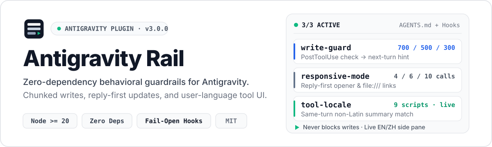
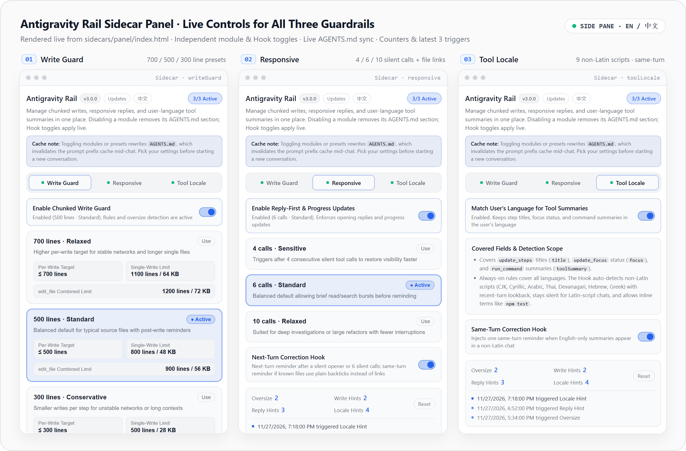
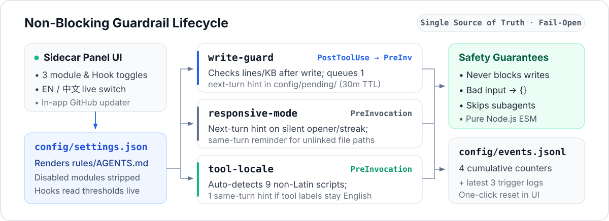

<p align="center">
  
</p>

<p align="center">
  <strong>English</strong> · <a href="./README.zh-CN.md">简体中文</a>
  &nbsp;&nbsp;|&nbsp;&nbsp;
  <a href="#quick-install">Quick Install</a> · <a href="#three-guardrail-modules">Guardrails</a> · <a href="#how-it-works">How It Works</a> · <a href="./CHANGELOG.md">Changelog</a>
</p>

Antigravity Rail is a zero-dependency Node.js plugin for [Antigravity](https://antigravity.google) that manages three behavioral guardrails from one side-pane UI (Sidecar): chunked writes, reply-first progress updates, and user-language tool summaries. Each module combines dynamically rendered `rules/AGENTS.md` instructions with non-blocking, fail-open Hooks.

<p align="center">
  
</p>

## Quick Install

Requires Node.js >= 20 and Antigravity. Zero npm packages are installed.

### Windows (PowerShell)

```powershell
git clone https://github.com/Lynn-zy/antigravity-rail.git
cd antigravity-rail
.\scripts\install.ps1
```

### macOS / Linux

```bash
git clone https://github.com/Lynn-zy/antigravity-rail.git
cd antigravity-rail
bash ./scripts/install.sh
```

The install script copies runtime files into `~/.gemini/config/plugins/antigravity-rail` without modifying Antigravity's `config.json`. Re-running it to upgrade removes stale `.mjs` files, preserves your `config/settings.json` preferences, and re-renders `rules/AGENTS.md`.

<details>
<summary>Uninstall or install to a custom directory</summary>

```powershell
# Windows: custom directory or uninstall
.\scripts\install.ps1 -TargetDir "D:\custom\antigravity-rail"
.\scripts\install.ps1 -Uninstall
```

```bash
# macOS / Linux: custom directory or uninstall
bash ./scripts/install.sh --target "/custom/path/antigravity-rail"
bash ./scripts/install.sh --uninstall
```

</details>

## Three Guardrail Modules

Each module has two independent controls in the side pane: a **module toggle** (turning it off removes its section from `rules/AGENTS.md` and pauses its Hook) and a **Hook toggle** (turning it off keeps the always-on rules without injecting reminders).

### 1. Chunked Write Guard (`write-guard`)

Prevents the model from dumping 1,000+ lines in a single `write_file` or full-file `edit_file` call, which slows streaming and risks mid-response drops.

- `PostToolUse` measures lines and UTF-8 bytes after a write finishes without blocking disk writes. Failed tool calls and pure deletions (empty `Replacement`) are skipped.
- Oversize writes are queued per `conversationId` hash in `config/pending/` (30-minute TTL). The next `PreInvocation` injects one reminder and deletes the queue file.

| Preset | Soft Target (`AGENTS.md`) | Single-Write Limit (`write_file`) | Combined Limit (`edit_file` Target + Replacement) |
| :--- | :---: | :---: | :---: |
| `700` · Relaxed | ≤ 700 lines | 1100 lines / 64 KB | 1200 lines / 72 KB |
| **`500` · Standard (default)** | **≤ 500 lines** | **800 lines / 48 KB** | **900 lines / 56 KB** |
| `300` · Conservative | ≤ 300 lines | 500 lines / 28 KB | 600 lines / 36 KB |

### 2. Reply-First & Progress Updates (`responsive-mode`)

Stops the agent from firing tools silently at the start of a turn or disappearing behind long collapsed "Exploring" streaks, and keeps workspace file references clickable.

- The first user message is never interrupted; compliant turns pass through silently.
- At the start of each turn, `PreInvocation` checks the previous turn in `transcript.jsonl`. If the model called tools with no opening text, or ran consecutive silent tool calls reaching the chosen preset (`4 · Sensitive` / `6 · Standard (default)` / `10 · Relaxed`), it injects `<responsive-mode>` once.
- Mid-turn, if the latest visible reply cites known workspace files in plain backticks instead of `[filename](file:///...)`, it injects `<responsive-file-links>` once per turn. Known files come from prior `read_file` / `edit_file` / `write_file` calls or `file:///` links in the session.
- Subagent sessions and background task events are skipped.

### 3. User-Language Tool Summaries (`tool-locale`)

Keeps `update_steps` step titles (`title`), `update_focus` status phrases (`focus`), and `run_command` summaries (`toolSummary`) in the user's language without patching any Antigravity binary.

- `rules/AGENTS.md` covers all languages while allowing necessary identifiers and CLI commands (such as `npm test` or `git status`).
- `PreInvocation` detects 9 non-Latin script families (Japanese, Korean, Chinese, Cyrillic, Arabic, Thai, Devanagari, Hebrew, and Greek). For short Latin replies like `"ok"` or `"continue"`, it looks back up to 5 user turns to determine the session language.
- When a pure-English summary appears in the current turn of a non-Latin chat, it injects `<tool-locale>` once before the next model call (max once per user turn). Latin-script chats and subagent sessions stay silent.

## How It Works

<p align="center">
  
</p>

- **Single source of truth**: All thresholds, defaults, and `rules/AGENTS.md` templates live in [`scripts/config.mjs`](./scripts/config.mjs). Side-pane edits write atomically to `config/settings.json` and re-render `rules/AGENTS.md`.
- **Side-pane UI & telemetry**: Adapts to Antigravity's dark and light themes and switches live between English and Chinese. The footer tracks 4 cumulative counters (`Oversize`, `Write Hints`, `Reply Hints`, `Locale Hints`) plus the latest 3 timestamped triggers, with one-click reset.
- **Changelog & in-place updates**: Clicking the version pill opens the local `CHANGELOG.md`. Clicking "Updates" checks GitHub, verifies and installs new versions in-place with automatic rollback, and preserves local settings and stats.
- **Prompt cache note**: Toggling a module or preset rewrites `rules/AGENTS.md`, which invalidates the prompt prefix cache on the next turn. Choose your settings before starting a new conversation.

## What This Plugin Does Not Do

- Oversize writes always finish saving to disk; reminders are strictly post-write and never discard generated output.
- All config, pending queues, and event logs stay inside the plugin directory without touching host binaries or `config.json`.
- Any malformed Hook payload, missing transcript, or I/O error outputs `{}` so Antigravity continues normally.

## Development & Verification

Run the built-in Node test suite (28 unit and CLI tests, zero dependencies):

```bash
npm test
```

After modifying presets or rule templates in `scripts/config.mjs`, resync the repository's default `rules/AGENTS.md` (do not commit generated `config/settings.json`):

```bash
node -e "import('./scripts/config.mjs').then(m => m.syncRulesFromSettings())"
```

<details>
<summary>Repository layout</summary>

```text
.
├── plugin.json                     # Antigravity plugin manifest
├── hooks.json                      # Independent Hook declarations (write-guard / responsive-mode / tool-locale)
├── CHANGELOG.md                    # Release history rendered inside the Sidecar modal
├── assets/
│   ├── logo.svg                    # Plugin icon
│   └── readme/                     # README visual assets (not copied into runtime install)
├── rules/AGENTS.md                 # Dynamically rendered guardrail rules
├── scripts/
│   ├── config.mjs                  # Unified 3-module settings model, presets, and AGENTS.md renderer
│   ├── stats.mjs                   # Append-only trigger log (events.jsonl) and reset helper
│   ├── transcript.mjs              # Tail-window transcript reader and fail-open Hook CLI wrapper
│   ├── write-guard-core.mjs        # PostToolUse size checks and pending reminder queue
│   ├── write-guard-hook.mjs        # write-guard Hook entrypoint
│   ├── responsive-core.mjs         # Next-turn rhythm checks and same-turn file-link checks
│   ├── responsive-hook.mjs         # responsive-mode Hook entrypoint
│   ├── tool-locale-core.mjs        # 9-script non-Latin detection and same-turn summary checks
│   ├── tool-locale-hook.mjs        # tool-locale Hook entrypoint
│   ├── install.ps1                 # Windows installer and uninstaller
│   ├── install.sh                  # macOS / Linux installer and uninstaller
│   └── *.test.mjs                  # Node built-in test suite
└── sidecars/panel/
    ├── sidecar.json                # Sidecar panel declaration
    ├── main.mjs                    # Local HTTP server for the Sidecar UI
    ├── panel-logic.mjs             # State snapshots, settings updates, stats reset, changelog reader
    ├── updater.mjs                 # Zero-dependency GitHub updater with verification and rollback
    └── index.html                  # Three-tab bilingual Sidecar UI (auto dark/light theme)
```

</details>

## License

[MIT](./LICENSE)
