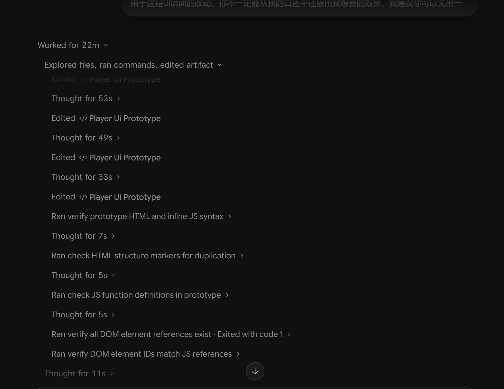
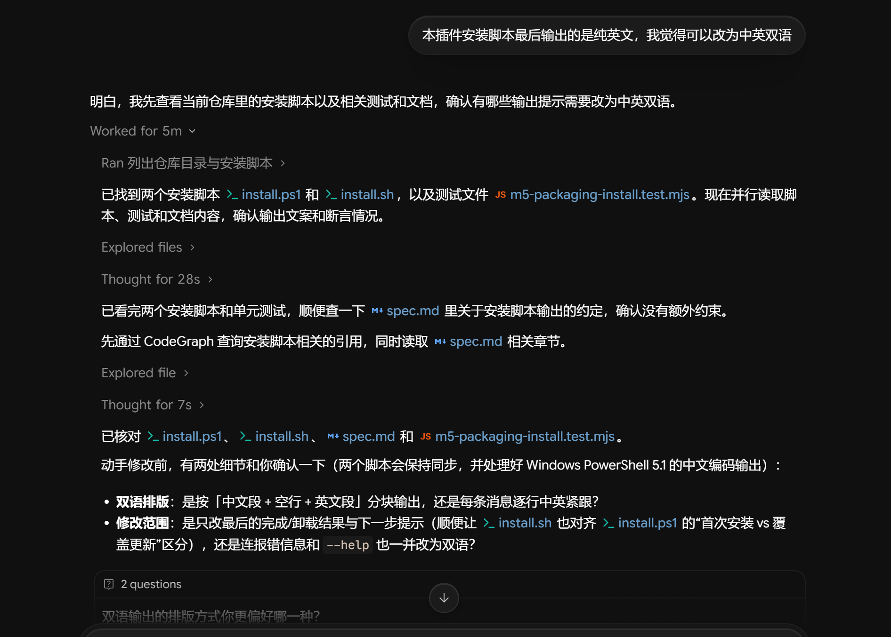
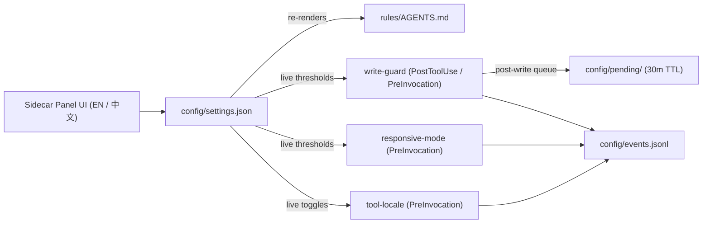

<div align="center">


# Antigravity Rail

**Stop Antigravity from going silent for 20 minutes, dumping 1,000-line writes, or reverting to English tool labels.**

Zero-dependency behavioral guardrails for [Antigravity](https://antigravity.google) — dynamic `AGENTS.md` rules paired with fail-open Hooks and one live side-pane UI.

[](./CHANGELOG.md)
[](https://github.com/Lynn-zy/antigravity-rail/commits/main)
[](./package.json)
[](./LICENSE)

**English** · [简体中文](./README.zh-CN.md)

</div>

---

## See the Difference

<table>
  <thead>
    <tr>
      <th width="50%">Without Antigravity Rail</th>
      <th width="50%">With Antigravity Rail</th>
    </tr>
  </thead>
  <tbody>
    <tr>
      <td></td>
      <td></td>
    </tr>
    <tr>
      <td>Silent for 22 minutes, no opening reply, collapsed tool calls, pure-English tool summaries in a Chinese conversation.</td>
      <td>Immediate opening reply, localized tool summaries, mid-task progress updates, and clickable workspace file links.</td>
    </tr>
  </tbody>
</table>

## Why Not Just Static `AGENTS.md`?

Static instructions in `AGENTS.md` or `GEMINI.md` fade during long multi-step turns. Once the agent stops replying before tools, emits a 1,200-line file write, drops `file:///` links, or slips back to English `toolSummary` labels, static text cannot course-correct until you interrupt it manually.

Antigravity Rail pairs dynamically rendered `rules/AGENTS.md` with three lightweight, **fail-open** runtime Hooks (`PostToolUse` and `PreInvocation`) and a **Sidecar UI**:

| Capability | Static `AGENTS.md` | Antigravity Rail |
| :--- | :--- | :--- |
| Mid-conversation drift correction | None until you interrupt | Injects one targeted Hook reminder only when a violation happens |
| Changing thresholds or toggling rules | Edit Markdown manually | Flip modules, Hooks, and presets live in the side pane |
| Runtime footprint | Text only | Pure Node.js ESM (`>= 20`), 0 npm dependencies, never modifies `config.json` |

**When you don't need it:** If you work exclusively in English on short single-turn prompts and rarely write files over 500 lines, a few static lines in your own `AGENTS.md` are enough.

## Quick Install

Requires **Node.js >= 20** and **Antigravity**. Zero npm packages are installed.

### Windows (PowerShell)

```powershell
git clone https://github.com/Lynn-zy/antigravity-rail.git
cd antigravity-rail
.\scripts\install.ps1
```

### macOS / Linux

```bash
git clone https://github.com/Lynn-zy/antigravity-rail.git
cd antigravity-rail
bash ./scripts/install.sh
```

Expected output on a fresh install (`3/3 modules enabled: 500-line write preset / 6-call silent preset`):

```text
[antigravity-rail] 安装/更新完成：.../.gemini/config/plugins/antigravity-rail
[antigravity-rail] 当前状态：3/3 模块已启用（写入 500 行档 / 静默 6 次档）
```

Then open **Antigravity Rail** from Antigravity's side pane to confirm it loaded (on first install, reload Antigravity if the plugin does not appear immediately). The installer copies runtime files into `~/.gemini/config/plugins/antigravity-rail` without modifying Antigravity's `config.json`. Re-running it to upgrade removes stale `.mjs` files, preserves `config/settings.json`, re-renders `rules/AGENTS.md`, and restarts any running Sidecar automatically via `config/sidecar.pid`.

<details>
<summary>Custom install directory or uninstall</summary>

```powershell
# Windows
.\scripts\install.ps1 -TargetDir "D:\custom\antigravity-rail"
.\scripts\install.ps1 -Uninstall
```

```bash
# macOS / Linux
bash ./scripts/install.sh --target "/custom/path/antigravity-rail"
bash ./scripts/install.sh --uninstall
```

Uninstalling stops the running Sidecar process (when `config/sidecar.pid` matches a live Node process) before deleting the plugin directory.

</details>

## Three Guardrail Modules

Each module has two independent toggles in the side pane:

- **Module toggle**: Turning it off removes that module's section from `rules/AGENTS.md` and pauses its Hook.
- **Hook toggle**: Turning it off keeps the always-on `rules/AGENTS.md` instructions while disabling runtime reminder injection.

### 1. Chunked Write Guard (`write-guard`)

Prevents single `write_file` or full-file `edit_file` calls from streaming 1,000+ lines at once, which slows responses and risks mid-stream drops.

- `PostToolUse` counts lines and UTF-8 bytes after the write saves to disk—never blocking writes. Failed tool calls and pure deletions (empty `Replacement`) are skipped.
- Oversize writes queue per `conversationId` hash in `config/pending/` (30-minute TTL). The next `PreInvocation` injects one reminder (`[antigravity-rail:oversize-reminder]`) and removes the queue file.

| Preset | Soft Target (`AGENTS.md`) | `write_file` Limit | `edit_file` Combined Limit (`Target + Replacement`) |
| :--- | :---: | :---: | :---: |
| `700` · Relaxed | ≤ 700 lines | 1100 lines / 64 KB | 1200 lines / 72 KB |
| **`500` · Standard (default)** | **≤ 500 lines** | **800 lines / 48 KB** | **900 lines / 56 KB** |
| `300` · Conservative | ≤ 300 lines | 500 lines / 28 KB | 600 lines / 36 KB |

### 2. Reply-First & Progress Updates (`responsive-mode`)

Stops the agent from firing tools silently at the start of a turn or disappearing behind collapsed "Exploring" streaks, and keeps workspace file mentions clickable.

- The first user message is never interrupted; compliant turns pass through silently.
- **Next-turn rhythm check**: `PreInvocation` reads the previous turn in `transcript.jsonl`. If the agent ran tools with no opening text, or hit consecutive silent tool calls at the selected preset (`4 · Sensitive` / **`6 · Standard (default)`** / `10 · Relaxed`), it injects `<responsive-mode>` once.
- **Same-turn file-link check**: Mid-turn, if the latest visible reply cites known workspace files (from prior `read_file` / `edit_file` / `write_file` calls or `file:///` links in the session) in plain backticks instead of `[filename](file:///...)`, it injects `<responsive-file-links>` once per turn.
- Subagent sessions and background task events are skipped.

### 3. User-Language Tool Summaries (`tool-locale`)

Keeps `update_steps` titles (`title`), `update_focus` status messages (`focus`), and `run_command` summaries (`toolSummary`) in the user's language without patching any Antigravity binary.

- `rules/AGENTS.md` covers all languages while allowing necessary code identifiers, paths, and CLI commands (such as `npm test` or `git status`).
- `PreInvocation` detects 9 non-Latin script families: Japanese, Korean, Chinese, Cyrillic, Arabic, Thai, Devanagari, Hebrew, and Greek. For short Latin replies like `"ok"` or `"continue"`, it looks back up to 5 user turns.
- If a pure-English summary appears in the current turn of a non-Latin chat, it injects `<tool-locale>` once before the next model call (max once per user turn). Latin-script chats and subagents stay silent.

## Live Side-Pane Control

<p align="center">
  
</p>

- **Theme & language**: Follows Antigravity's dark and light themes automatically and switches live between English and Chinese in the header.
- **Trigger telemetry**: Tracks 4 cumulative counters (`Oversize`, `Write Hints`, `Reply Hints`, `Locale Hints`) plus the latest 3 timestamped triggers from `config/events.jsonl`, with one-click reset.
- **Changelog & in-place updates**: Click the version pill to read local [`CHANGELOG.md`](./CHANGELOG.md). Click **Updates** to check GitHub releases/tags, verify the archive, and swap runtime files in-place with automatic rollback while keeping local settings and stats.

> [!NOTE]
> Toggling a module or changing a preset rewrites `rules/AGENTS.md`, which invalidates the prompt prefix cache on the next turn. Choose your settings before starting a new conversation.

## Architecture & Safety Guarantees



- **Never blocks disk writes**: Oversize writes always complete; reminders arrive after the write on the next turn.
- **Fail-open everywhere**: Malformed stdin, corrupted JSON, missing `transcript.jsonl`, or disk errors return `{}` so Antigravity continues normally.
- **Single source of truth**: All thresholds, defaults, and `rules/AGENTS.md` templates live in [`scripts/config.mjs`](./scripts/config.mjs). Side-pane edits write atomically to `config/settings.json` and sync `rules/AGENTS.md`.
- **Self-contained footprint**: Settings, pending queues, PID file, and event logs stay inside the plugin directory without touching host binaries or `config.json`.

## Development & Status

**Status**: Actively maintained (`v3.0.0`, 2026-11-26), used daily by the author. Bug reports and PRs are welcome via [GitHub Issues](https://github.com/Lynn-zy/antigravity-rail/issues); full release history is in [`CHANGELOG.md`](./CHANGELOG.md).

Run the built-in Node test suite (**29** unit and CLI tests, zero dependencies):

```bash
npm test
```

After editing presets or rule templates in [`scripts/config.mjs`](./scripts/config.mjs), resync the repository's default `rules/AGENTS.md` (do not commit generated `config/settings.json`):

```bash
node -e "import('./scripts/config.mjs').then(m => m.syncRulesFromSettings())"
```

<details>
<summary>Repository layout</summary>

```text
.
├── plugin.json                     # Antigravity plugin manifest
├── hooks.json                      # Independent Hook declarations (write-guard / responsive-mode / tool-locale)
├── CHANGELOG.md                    # Release history rendered inside the Sidecar modal
├── assets/
│   ├── logo.svg                    # Plugin icon
│   └── readme/                     # README screenshots (not copied into runtime install)
├── rules/AGENTS.md                 # Dynamically rendered guardrail rules
├── scripts/
│   ├── config.mjs                  # Single source of truth for settings, presets, and AGENTS.md rendering
│   ├── stats.mjs                   # Append-only trigger log (events.jsonl) and reset helper
│   ├── transcript.mjs              # Tail-window transcript reader and fail-open Hook CLI wrapper
│   ├── write-guard-core.mjs        # PostToolUse size checks and pending reminder queue
│   ├── write-guard-hook.mjs        # write-guard Hook entrypoint
│   ├── responsive-core.mjs         # Next-turn rhythm checks and same-turn file-link checks
│   ├── responsive-hook.mjs         # responsive-mode Hook entrypoint
│   ├── tool-locale-core.mjs        # 9-script non-Latin detection and same-turn summary checks
│   ├── tool-locale-hook.mjs        # tool-locale Hook entrypoint
│   ├── install.ps1                 # Windows installer, upgrader, and uninstaller
│   ├── install.sh                  # macOS / Linux installer, upgrader, and uninstaller
│   └── *.test.mjs                  # Node built-in test suite (29 tests)
└── sidecars/panel/
    ├── sidecar.json                # Sidecar panel declaration
    ├── main.mjs                    # Local HTTP server and PID lifecycle for the Sidecar UI
    ├── panel-logic.mjs             # State snapshots, settings updates, stats reset, changelog reader
    ├── updater.mjs                 # Zero-dependency GitHub updater with verification and rollback
    └── index.html                  # Three-tab bilingual Sidecar UI (auto dark/light theme)
```

</details>

## License

[MIT](./LICENSE)
