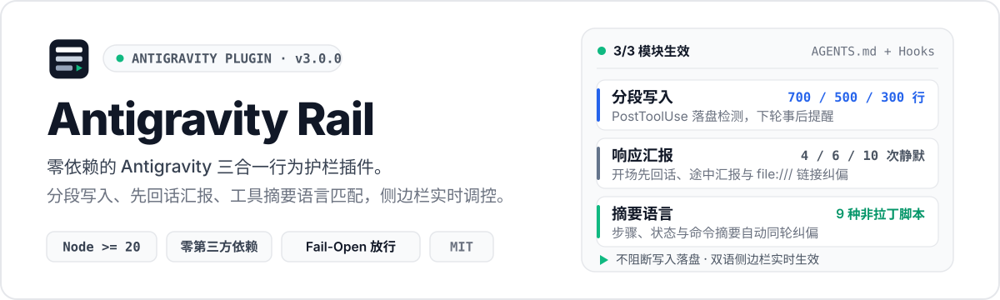
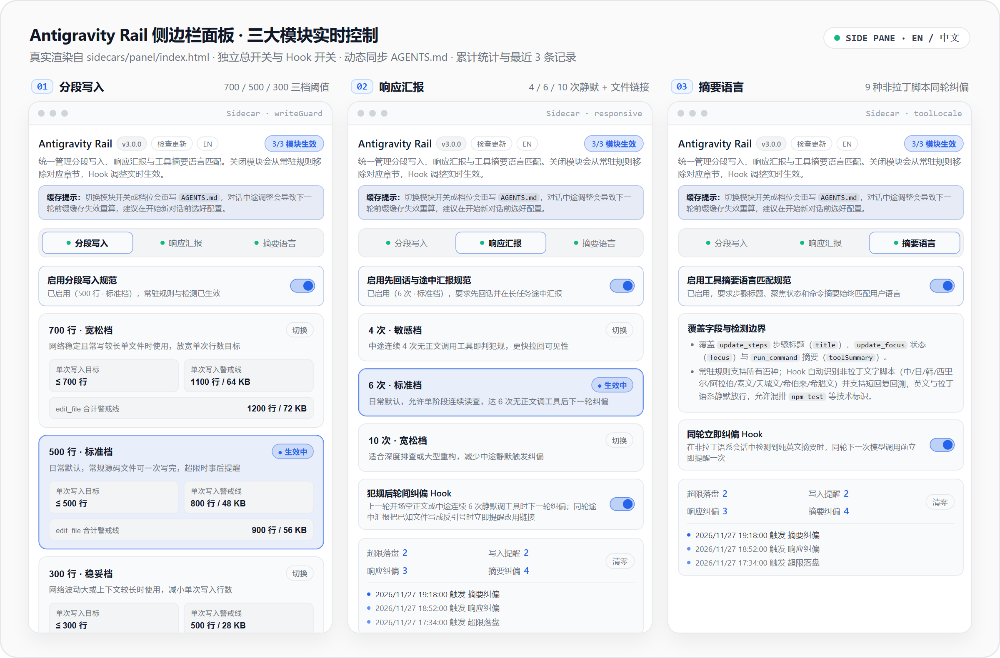
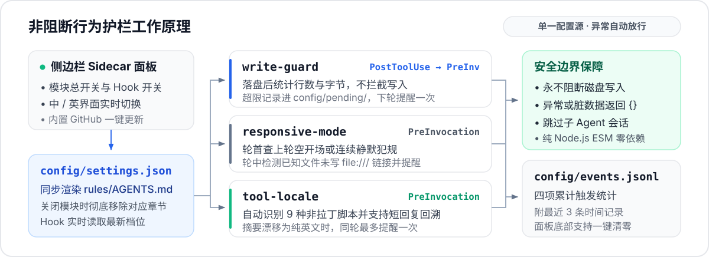

<p align="center">
  
</p>

<p align="center">
  <a href="./README.md">English</a> · <strong>简体中文</strong>
  &nbsp;&nbsp;|&nbsp;&nbsp;
  <a href="#快速安装">快速安装</a> · <a href="#三大护栏模块">护栏模块</a> · <a href="#工作原理与侧边栏面板">工作原理</a> · <a href="./CHANGELOG.md">变更日志</a>
</p>

Antigravity Rail 是零第三方依赖的 [Antigravity](https://antigravity.google) 行为护栏插件，在同一个侧边栏面板（Sidecar UI）里管理分段写入、先回话与途中汇报、工具摘要语言匹配三个模块。每个模块由动态渲染的 `rules/AGENTS.md` 常驻规则和对应的 Hook 组成，不拦截落盘，异常时自动放行（`fail-open`）。

<p align="center">
  
</p>

## 快速安装

需要本机已安装 Node.js >= 20 和 Antigravity，无需安装任何 npm 依赖。

### Windows (PowerShell)

```powershell
git clone https://github.com/Lynn-zy/antigravity-rail.git
cd antigravity-rail
.\scripts\install.ps1
```

### macOS / Linux

```bash
git clone https://github.com/Lynn-zy/antigravity-rail.git
cd antigravity-rail
bash ./scripts/install.sh
```

安装脚本将运行时文件复制到 `~/.gemini/config/plugins/antigravity-rail`，不改动 Antigravity 的 `config.json`。再次运行脚本升级时，会清理旧 `.mjs` 残留，保留 `config/settings.json` 中的设置，并按当前设置重渲染 `rules/AGENTS.md`。

<details>
<summary>卸载或指定自定义安装目录</summary>

```powershell
# Windows：自定义目录安装或卸载
.\scripts\install.ps1 -TargetDir "D:\custom\antigravity-rail"
.\scripts\install.ps1 -Uninstall
```

```bash
# macOS / Linux：自定义目录安装或卸载
bash ./scripts/install.sh --target "/custom/path/antigravity-rail"
bash ./scripts/install.sh --uninstall
```

</details>

## 三大护栏模块

三个模块在侧边栏面板里都有独立的**模块总开关**和 **Hook 开关**。关闭模块总开关后，插件会从 `rules/AGENTS.md` 移除对应章节并停用 Hook；只关闭 Hook 时保留常驻规则，不再向模型上下文注入提醒。

### 1. 分段写入（`write-guard`）

避免模型在单次 `write_file` 或大范围覆盖式 `edit_file` 中输出上千行，拖慢流式响应或中断写入。

- `PostToolUse` 在写入完成后统计行数与 UTF-8 字节数，不拦截落盘；纯删除（`Replacement` 为空）和工具报错调用跳过统计。
- 超过警戒线时，Hook 按 `conversationId` 哈希把记录写入 `config/pending/`（30 分钟过期）。下一次 `PreInvocation` 注入一次事后提醒，并立即删除这条待提醒记录。

| 档位 | 单次写入目标（`AGENTS.md`） | 单次写入警戒线（`write_file`） | `edit_file` 合计警戒线（`Target + Replacement`） |
| :--- | :---: | :---: | :---: |
| `700` 行 · 宽松档 | ≤ 700 行 | 1100 行 / 64 KB | 1200 行 / 72 KB |
| **`500` 行 · 标准档（默认）** | **≤ 500 行** | **800 行 / 48 KB** | **900 行 / 56 KB** |
| `300` 行 · 稳妥档 | ≤ 300 行 | 500 行 / 28 KB | 600 行 / 36 KB |

### 2. 先回话与途中汇报（`responsive-mode`）

避免 Agent 接到任务不回话就直接调工具、连续静默被折叠成 Exploring，以及回复中引用工作区文件时漏加可点击链接。

- 会话首条用户消息不注入 Hook，遵守规则的多轮对话直接放行。
- 新一轮开始时，`PreInvocation` 检查 `transcript.jsonl` 中的上一轮记录。若上一轮开场无正文就直接调工具，或中途连续静默调工具达到设定档位（`4 次 · 敏感档` / `6 次 · 标准档（默认）` / `10 次 · 宽松档`），则注入一次 `<responsive-mode>` 提醒。
- 同一轮中途，如果刚发出的正文把已知工作区文件写成了纯反引号，下一次调用前立即注入一次 `<responsive-file-links>` 提醒。已知文件取自本会话此前的 `read_file` / `edit_file` / `write_file` 参数或 `file:///` 链接。
- 自动跳过子 Agent 会话和后台任务事件。

### 3. 工具摘要语言匹配（`tool-locale`）

不修改 Antigravity 二进制文件，让 `update_steps` 步骤标题（`title`）、`update_focus` 状态说明（`focus`）与 `run_command` 摘要（`toolSummary`）匹配用户当前语言。

- `rules/AGENTS.md` 常驻规则覆盖所有语种，允许在自然语言短语中保留必要的代码标识符、路径或命令名，例如「运行 `npm test`」。
- Hook 自动识别 9 种非拉丁脚本（日文、韩文、中文、西里尔文、阿拉伯文、泰文、天城文、希伯来文、希腊文）。遇到 `"ok"`、`"continue"` 这类纯拉丁短回复时，最多向前查看 5 条用户消息来判断会话语言。
- 非拉丁语系会话的本轮工具摘要出现纯英文短语时，下一次模型调用前注入一次 `<tool-locale>` 提醒，每用户轮次最多一次。英文、拉丁语系对话及子 Agent 会话不注入。

## 工作原理与侧边栏面板

<p align="center">
  
</p>

- **单一配置与规则源**：三模块档位、默认开关和 `rules/AGENTS.md` 模板集中在 [`scripts/config.mjs`](./scripts/config.mjs)。在侧边栏面板修改开关或档位时，插件原子写入 `config/settings.json`，并同步重渲染 `rules/AGENTS.md`。
- **界面与统计**：侧边栏面板自动适配 Antigravity 暗色与浅色主题，顶栏可切换中/英界面。底部展示四项累计触发次数（超限落盘、写入提醒、响应纠偏、摘要纠偏）及最近 3 条带时间戳的触发记录，可一键清零。
- **变更日志与原地更新**：点击顶栏版本号可查看本地 `CHANGELOG.md`；点击「检查更新」可从 GitHub 下载新版本原地替换，失败时自动回滚，保留本地设置和统计日志。
- **前缀缓存提示**：在对话中途切换模块总开关或档位会重写 `rules/AGENTS.md`，下一轮提示词前缀缓存会失效重算。建议在开启新对话前选好配置。

## 设计边界

- 超限写入始终允许完整落盘，只在下一轮做一次事后提醒，不丢弃已生成的内容。
- 所有配置、待提醒队列和事件日志都留在插件目录内，不修改宿主二进制文件或 `config.json`。
- 任何 Hook 遇到非法 stdin、损坏 JSON、缺失会话记录或磁盘读写异常时，一律输出 `{}` 放行。

## 本地开发与测试

运行 Node 内置测试套件（共 28 条单测与 CLI 集成测试，零外部依赖）：

```bash
npm test
```

修改 `scripts/config.mjs` 中的档位或常驻规则模板后，运行以下命令同步仓库默认 `rules/AGENTS.md`（不要将临时生成的 `config/settings.json` 提交入库）：

```bash
node -e "import('./scripts/config.mjs').then(m => m.syncRulesFromSettings())"
```

<details>
<summary>仓库目录结构</summary>

```text
.
├── plugin.json                     # Antigravity 插件清单
├── hooks.json                      # 三个独立 Hook 声明（write-guard / responsive-mode / tool-locale）
├── CHANGELOG.md                    # 变更日志（侧边栏点击版本号弹窗渲染）
├── assets/
│   ├── logo.svg                    # 插件图标
│   └── readme/                     # README 视觉素材（不随安装脚本复制到运行目录）
├── rules/AGENTS.md                 # 动态渲染的常驻规则（与侧边栏面板配置同步）
├── scripts/
│   ├── config.mjs                  # 统一三模块配置模型、档位预设与 AGENTS.md 渲染
│   ├── stats.mjs                   # 四项触发事件日志（events.jsonl）与清零
│   ├── transcript.mjs              # 公共会话记录窗口读取与 fail-open Hook CLI 入口
│   ├── write-guard-core.mjs        # 分段写入落盘检测与事后提醒排队逻辑
│   ├── write-guard-hook.mjs        # write-guard Hook 入口
│   ├── responsive-core.mjs         # 轮首空开场/连续静默检测与轮中文件链接纠偏
│   ├── responsive-hook.mjs         # responsive-mode Hook 入口
│   ├── tool-locale-core.mjs        # 9 种非拉丁脚本自动识别与同轮摘要纠偏
│   ├── tool-locale-hook.mjs        # tool-locale Hook 入口
│   ├── install.ps1                 # Windows 安装与卸载脚本
│   ├── install.sh                  # macOS / Linux 安装与卸载脚本
│   └── *.test.mjs                  # 全套单元测试
└── sidecars/panel/
    ├── sidecar.json                # 侧边栏 Sidecar 面板声明
    ├── main.mjs                    # Sidecar 本地 HTTP 服务入口
    ├── panel-logic.mjs             # 面板状态查询、统一配置更新、统计清零与日志读取
    ├── updater.mjs                 # 零依赖 GitHub 更新检测、校验与安全回滚替换
    └── index.html                  # 三标签中英双语侧边栏面板页面（自适应宿主主题）
```

</details>

## License

[MIT](./LICENSE)
