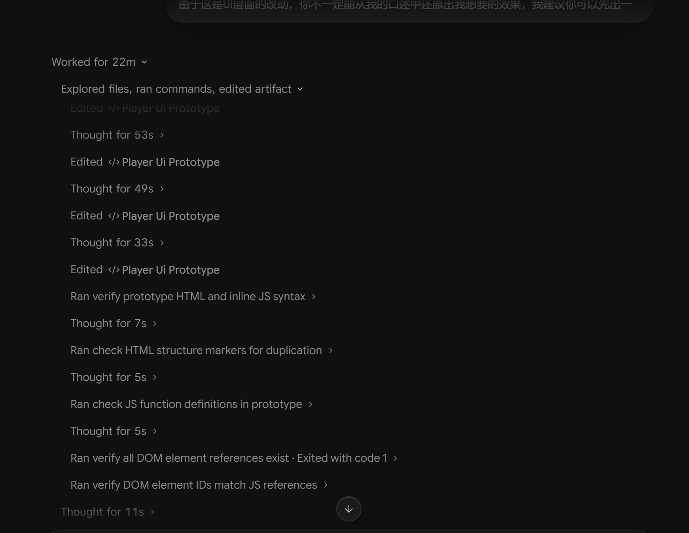
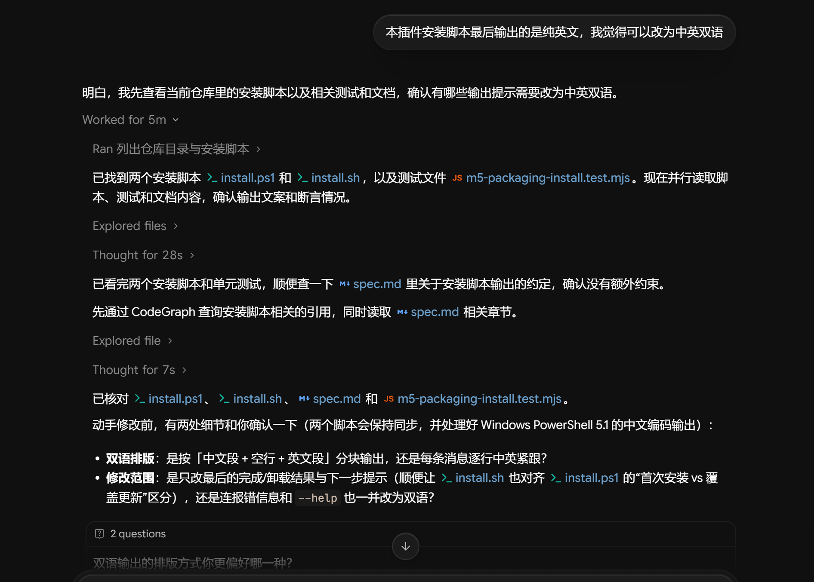
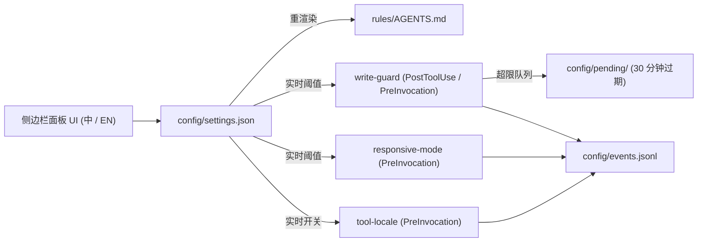

<div align="center">


# Antigravity Rail

**让 Antigravity 不再静默干活 20 分钟、单次狂写上千行，也不再把工具摘要回退成纯英文。**

零第三方依赖的 [Antigravity](https://antigravity.google) 行为护栏插件，在同一个侧边栏面板中管理动态 `AGENTS.md` 常驻规则与非阻断 Hook。

[](./CHANGELOG.md)
[](https://github.com/Lynn-zy/antigravity-rail/commits/main)
[](./package.json)
[](./LICENSE)

[English](./README.md) · **简体中文**

</div>

---

## 安装前后对比

<table>
  <thead>
    <tr>
      <th width="50%">未安装 Antigravity Rail</th>
      <th width="50%">启用 Antigravity Rail 后</th>
    </tr>
  </thead>
  <tbody>
    <tr>
      <td></td>
      <td></td>
    </tr>
    <tr>
      <td>开场无回复，连续静默执行 22 分钟，工具调用折叠且摘要全为纯英文。</td>
      <td>接到任务先回话，工具摘要保持中文，阶段性汇报进展并附带可点击文件链接。</td>
    </tr>
  </tbody>
</table>

## 为什么不只写静态 `AGENTS.md`？

写在 `AGENTS.md` 或 `GEMINI.md` 里的静态约束在长对话中容易失效。一旦模型忘记先回话、单次输出 1200 行文件、引用文件漏加 `file:///` 链接，或把 `toolSummary` 写回纯英文，纯文本规则无法在运行中途拉回行为，只能人工打断。切换规则或修改阈值也必须手改文件。

Antigravity Rail 把动态生成的 `rules/AGENTS.md`、三个 `fail-open` 运行时 Hook（`PostToolUse` 与 `PreInvocation`）和侧边栏 Sidecar 面板组合在一起：

| 维度 | 静态 `AGENTS.md` | Antigravity Rail |
| :--- | :--- | :--- |
| 长对话偏航纠偏 | 只能靠人工打断 | 仅在检测到违规时注入一次定向提醒，正常轮次静默放行 |
| 开关与档位调整 | 手工编辑 Markdown | 在侧边栏实时切换模块开关、Hook 开关与阈值档位 |
| 运行开销与侵入性 | 纯文本 | 纯 Node.js ESM（>= 20），0 个 npm 依赖，不改动宿主 `config.json` |

**什么时候不需要安装**：如果你只用英文做短对话，且很少让模型单次写入超过 500 行的文件，直接在个人 `AGENTS.md` 里写几条静态规则就够了。

## 快速安装

需要本机已安装 **Node.js >= 20** 和 **Antigravity**，无需安装任何 npm 依赖。

### Windows (PowerShell)

```powershell
git clone https://github.com/Lynn-zy/antigravity-rail.git
cd antigravity-rail
.\scripts\install.ps1
```

### macOS / Linux

```bash
git clone https://github.com/Lynn-zy/antigravity-rail.git
cd antigravity-rail
bash ./scripts/install.sh
```

首次安装成功时会输出：

```text
[antigravity-rail] 安装/更新完成：.../.gemini/config/plugins/antigravity-rail
[antigravity-rail] 当前状态：3/3 模块已启用（写入 500 行档 / 静默 6 次档）
```

随后在 Antigravity 侧边栏中打开 **Antigravity Rail** 面板即可确认生效（首次安装若未立即出现，重载 Antigravity 即可）。安装脚本将运行时文件复制到 `~/.gemini/config/plugins/antigravity-rail`，不改动 Antigravity 的 `config.json`。再次运行脚本升级时，会清理旧 `.mjs` 残留，保留 `config/settings.json` 中的设置，按当前设置重渲染 `rules/AGENTS.md`，并通过 `config/sidecar.pid` 自动重启运行中的侧边栏 Sidecar。

<details>
<summary>自定义安装目录或卸载</summary>

```powershell
# Windows
.\scripts\install.ps1 -TargetDir "D:\custom\antigravity-rail"
.\scripts\install.ps1 -Uninstall
```

```bash
# macOS / Linux
bash ./scripts/install.sh --target "/custom/path/antigravity-rail"
bash ./scripts/install.sh --uninstall
```

卸载前若检测到 `config/sidecar.pid` 对应的 Node 进程仍在运行，脚本会先停止 Sidecar，再删除安装目录。

</details>

## 三大护栏模块

三个模块在侧边栏面板中都提供两个独立开关：

- **模块总开关**：关闭后，插件从 `rules/AGENTS.md` 移除对应章节，同时停用该模块的 Hook。
- **Hook 开关**：关闭后保留 `rules/AGENTS.md` 中的常驻规则，不再向模型上下文注入纠偏提醒。

### 1. 分段写入（`write-guard`）

避免模型在单次 `write_file` 或大范围覆盖式 `edit_file` 中一次输出上千行，拖慢流式输出或中途断流。

- `PostToolUse` 在写入完成后统计行数与 UTF-8 字节数，不拦截落盘。失败的工具调用与纯删除（`Replacement` 为空）跳过统计。
- 超出警戒线时，Hook 按 `conversationId` 哈希把记录写入 `config/pending/`（30 分钟过期）。下一次 `PreInvocation` 注入一次事后提醒（`[antigravity-rail:oversize-reminder]`），并立即删除该队列文件。

| 档位 | 单次写入目标（`AGENTS.md`） | `write_file` 警戒线 | `edit_file` 合计警戒线（`Target + Replacement`） |
| :--- | :---: | :---: | :---: |
| `700` 行 · 宽松档 | ≤ 700 行 | 1100 行 / 64 KB | 1200 行 / 72 KB |
| **`500` 行 · 标准档（默认）** | **≤ 500 行** | **800 行 / 48 KB** | **900 行 / 56 KB** |
| `300` 行 · 稳妥档 | ≤ 300 行 | 500 行 / 28 KB | 600 行 / 36 KB |

### 2. 先回话与途中汇报（`responsive-mode`）

避免 Agent 接到任务不回话就直接调工具、中途连续静默被折叠成 Exploring，以及提及工作区文件时漏加可点击链接。

- 会话首条用户消息不注入 Hook，遵守规则的多轮对话直接放行。
- **轮首节奏检测**：新一轮开始时，`PreInvocation` 检查 `transcript.jsonl` 中的上一轮记录。如果上一轮开场无正文就直接调工具，或中途连续静默调工具达到设定档位（`4 次 · 敏感档` / **`6 次 · 标准档（默认）`** / `10 次 · 宽松档`），则注入一次 `<responsive-mode>` 提醒。
- **轮中文件链接检测**：同一轮中途，如果最新可见回复把已知工作区文件写成了纯反引号而非 `[filename](file:///...)`，下一次调用前注入一次 `<responsive-file-links>` 提醒。已知文件来自本会话此前的 `read_file` / `edit_file` / `write_file` 参数或已出现的 `file:///` 链接。
- 自动跳过子 Agent 会话和后台任务事件。

### 3. 工具摘要语言匹配（`tool-locale`）

不修改 Antigravity 二进制文件，让 `update_steps` 步骤标题（`title`）、`update_focus` 状态说明（`focus`）与 `run_command` 摘要（`toolSummary`）匹配用户当前语言。

- `rules/AGENTS.md` 常驻规则覆盖所有语种，允许保留必要的代码标识符、文件路径或命令名（例如 `npm test`、`git status`）。
- `PreInvocation` 自动识别 9 种非拉丁脚本（日文、韩文、中文、西里尔文、阿拉伯文、泰文、天城文、希伯来文、希腊文）。遇到 `"ok"`、`"continue"` 这类纯拉丁短回复时，最多向前查看 5 条用户消息来判断会话语言。
- 非拉丁语系会话的本轮工具摘要出现纯英文短语时，下一次模型调用前注入一次 `<tool-locale>` 提醒，每用户轮次最多一次。英文、拉丁语系对话及子 Agent 会话不注入。

## 侧边栏实时面板

<p align="center">
  
</p>

- **主题与双语界面**：自动适配 Antigravity 暗色与浅色主题，顶栏支持实时切换中文与英文界面。
- **触发统计**：底部展示四项累计计数（超限落盘、写入提醒、响应纠偏、摘要纠偏）及来自 `config/events.jsonl` 的最近 3 条带时间戳触发记录，支持一键清零。
- **变更日志与原地更新**：点击顶栏版本号可查看本地 [`CHANGELOG.md`](./CHANGELOG.md)。点击「检查更新」可拉取 GitHub Releases 或 Tags，校验归档后原地替换运行时文件，失败时自动回滚，保留本地配置和统计日志。

> [!NOTE]
> 在对话中途切换模块总开关或档位会重写 `rules/AGENTS.md`，下一轮提示词前缀缓存会失效重算。建议在开启新对话前选好配置。

## 工作原理与安全边界



- **不阻断写入**：超限写入始终允许完整落盘，只在下一轮注入一次事后提醒，不丢弃已生成内容。
- **全程 fail-open**：任何 Hook 遇到非法 stdin、损坏 JSON、缺失 `transcript.jsonl` 或磁盘读写异常时，一律输出 `{}` 放行。
- **单一配置源**：三模块档位、默认开关和 `rules/AGENTS.md` 模板集中在 [`scripts/config.mjs`](./scripts/config.mjs)。面板改动原子写入 `config/settings.json` 并同步重渲染 `rules/AGENTS.md`。
- **目录自包含**：配置、待提醒队列、PID 文件和事件日志都留在插件目录内，不改动宿主二进制文件或 `config.json`。

## 本地开发与项目状态

**项目状态**：积极维护中（当前版本 `v3.0.0`，2026-11-26），作者日常主力使用。欢迎通过 [GitHub Issues](https://github.com/Lynn-zy/antigravity-rail/issues) 反馈问题或提交 PR，完整版本记录见 [`CHANGELOG.md`](./CHANGELOG.md)。

运行 Node 内置测试套件（共 **29** 条单测与 CLI 集成测试，零外部依赖）：

```bash
npm test
```

修改 [`scripts/config.mjs`](./scripts/config.mjs) 中的档位或常驻规则模板后，运行以下命令同步仓库默认 `rules/AGENTS.md`（不要将临时生成的 `config/settings.json` 提交入库）：

```bash
node -e "import('./scripts/config.mjs').then(m => m.syncRulesFromSettings())"
```

<details>
<summary>仓库目录结构</summary>

```text
.
├── plugin.json                     # Antigravity 插件清单
├── hooks.json                      # 三个独立 Hook 声明（write-guard / responsive-mode / tool-locale）
├── CHANGELOG.md                    # 变更日志（侧边栏点击版本号弹窗渲染）
├── assets/
│   ├── logo.svg                    # 插件图标
│   └── readme/                     # README 实拍与展板截图（不随安装脚本复制到运行目录）
├── rules/AGENTS.md                 # 动态渲染的常驻规则（与侧边栏面板配置同步）
├── scripts/
│   ├── config.mjs                  # 统一三模块配置模型、档位预设与 AGENTS.md 渲染
│   ├── stats.mjs                   # 四项触发事件日志（events.jsonl）与清零
│   ├── transcript.mjs              # 公共会话记录窗口读取与 fail-open Hook CLI 入口
│   ├── write-guard-core.mjs        # 分段写入落盘检测与事后提醒排队逻辑
│   ├── write-guard-hook.mjs        # write-guard Hook 入口
│   ├── responsive-core.mjs         # 轮首空开场/连续静默检测与轮中文件链接纠偏
│   ├── responsive-hook.mjs         # responsive-mode Hook 入口
│   ├── tool-locale-core.mjs        # 9 种非拉丁脚本自动识别与同轮摘要纠偏
│   ├── tool-locale-hook.mjs        # tool-locale Hook 入口
│   ├── install.ps1                 # Windows 安装、升级与卸载脚本
│   ├── install.sh                  # macOS / Linux 安装、升级与卸载脚本
│   └── *.test.mjs                  # Node 内置测试套件（共 29 条测试）
└── sidecars/panel/
    ├── sidecar.json                # 侧边栏 Sidecar 面板声明
    ├── main.mjs                    # Sidecar 本地 HTTP 服务与 PID 生命周期管理
    ├── panel-logic.mjs             # 面板状态查询、统一配置更新、统计清零与日志读取
    ├── updater.mjs                 # 零依赖 GitHub 更新检测、校验与安全回滚替换
    └── index.html                  # 三标签中英双语侧边栏面板页面（自适应宿主主题）
```

</details>

## License

[MIT](./LICENSE)
